# ClefpertSystems

A running Prolog expert system is the source of truth for model-training data:

**Prolog program → case generator → executable oracle → input/decision pairs → Clef exporter → model/oracle regression tests.**

The first system reconstructs cement-industry impact reasoning inspired by [Pandu Wisaksono Sastrowardoyo’s thesis](https://digilib.itb.ac.id/gdl/view_data/penggunaan-penilaian-metoda-dampak-warner-preston-dalam-program-komputer-sistem-pakar-analisa-dampak-industri-semen). ESC uses Leopold/Sorensen for impact analysis and Warner–Preston for methodology assessment. The lost code is not recovered: this is a deliberately approximate, executable reconstruction with documented facts and clearly labeled inferred logic.

## Three phases

1. **Small running system:** [prototype.pl](knowledge_base/prototype.pl), with a frozen fact subset and reasoning tests.
2. **Expanded reconstruction:** [esc1.pl](knowledge_base/esc1.pl), 223 thesis-derived documented facts, 13 processes, seven pollutants, twenty environmental components, forward/backward inference, social effects, mitigations, concentration bands, instrumentation, twenty Warner–Preston criteria and session assessment.
3. **Translation:** [translate_prolog.py](scripts/translate_prolog.py) runs any Prolog module implementing the adapter contract. It generates targets from executable behavior, never from thesis summaries.

The base system also includes **twelve current US EPA ambient-air reference standards**, sourced online from EPA’s table (updated November 2025, retrieved October 2026). The new screening workflow preserves units, averaging periods and statistical forms. See [current standards and update scope](docs/current-standards.md). Historical thesis relationships and inferred score logic remain explicitly identified; this is not a blanket claim that all historical data have been modernized.

See [prototype notes](docs/prototype.md), [expanded reconstruction](docs/expanded-reconstruction.md), [methodology](docs/reconstruction-methodology.md) and [adapter contract](docs/prolog-adapter.md).

## Run

Requirements: Python 3.10+ and SWI-Prolog 9.x. Use `swipl` on PATH, or set `SWIPL` for Python commands. No model credentials or Python packages are required.

```sh
swipl -q -s knowledge_base/prototype.pl -g prototype:demo -t halt
swipl -q -s knowledge_base/esc1.pl -g esc1:demo -t halt
python scripts/run_oracle.py --input examples/session.json
python scripts/run_oracle.py --input examples/current_ambient.json
python scripts/generate_cases.py
python -m unittest discover -s tests -v
swipl -q -s tests/test_prototype.pl -g run_tests -t halt
python scripts/export_clef_dataset.py --input dataset/generated/train.jsonl --output dataset/generated/train.messages.jsonl --format messages
python scripts/validate_against_prolog.py --cases dataset/generated/test.jsonl --predictions examples/test_predictions.jsonl --report dataset/generated/evaluation.json
```

The generated corpus contains **3,136 executable cases**: 2,063 train, 359 validation, 714 test. It covers 244 of 251 fact/inference IDs; the seven uncovered IDs are reported explicitly. Splits keep pollutant families, current/historical counterparts and equivalent unit/statistic variants together and group Warner–Preston sessions. These are generalization holdouts, not IID random rows.

<!-- BEGIN DAILY USE RUN -->
## Executed Prolog daily-use test

This run executes the **actual SWI-Prolog code** (`knowledge_base/esc1.pl`) in this environment. Roles and inputs are scripted; the decisions come from Prolog. Python renders the returned results into reports and checks them against fresh Prolog executions.

The [testing plan](docs/daily-use-testing.md) and [scenario inputs](examples/daily_use_plan.json) cover five synthetic workdays, 11 consultations per day, instrument checks, air/water reasoning, missing evidence, backward tracing, current ambient summaries, alternatives and session-driven reporting.

**Result:** 55 consultations, five assessment-support reports, four expected malformed-input rejections, 149 passed scenario/replay/report checks, 32 Python tests and three Prolog tests. All 55 full answers matched a fresh Prolog batch replay. Three malformed requests reached Prolog and were rejected; the boolean magnitude was rejected by the input adapter.

Runtime: **SWI-Prolog version 9.2.9 for x86_64-linux**. Actual execution: **11 October 2026 UTC**; scenario dates: **5–9 October 2026**. These are scripted workflow tests with synthetic observations, not real human-use research, monitoring data or statutory EIAs. Current ambient summaries retain their declared averaging periods.

[Run manifest](docs/runs/daily-use/manifest.json) · [149 checks](docs/runs/daily-use/verification.json) · [Actual runtime commands and outputs](docs/runs/daily-use/runtime-verification.json) · [All 71 screenshots with hashes](docs/runs/daily-use/screenshots.json)

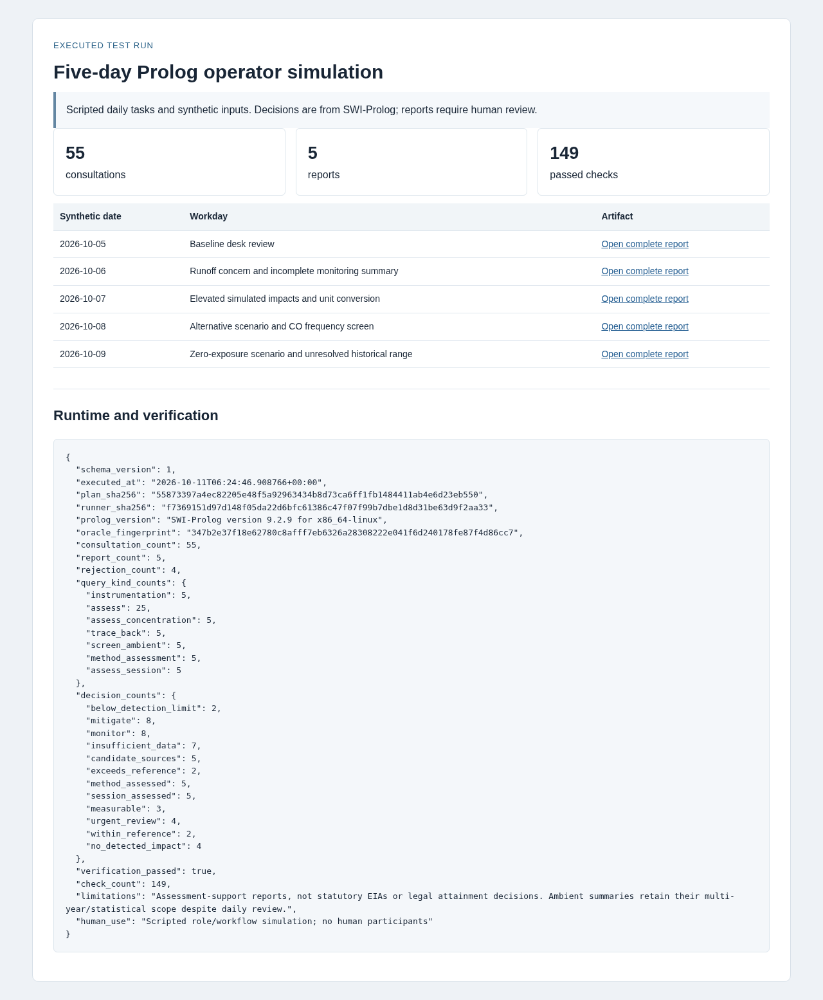

The following capture shows a **direct Prolog invocation**, loading `esc1.pl` and calling `esc1:demo`, with actual stdout and exit code. The other screenshots render saved Prolog results or actual subprocess transcripts in Chromium; no mock engine or generated illustration supplies the output.

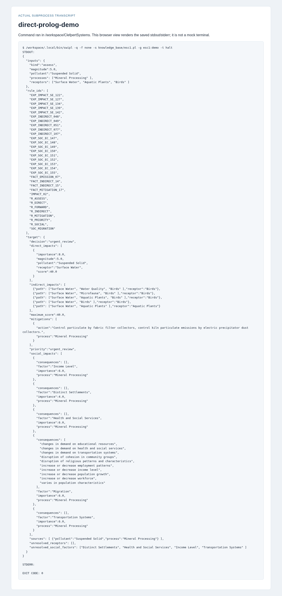

| Synthetic workday | Highest reconstructed baseline priority | Current ambient screen |
| --- | --- | --- |
| 2026-10-05 — Baseline desk review | `mitigate` | `exceeds_reference` |
| 2026-10-06 — Runoff concern and incomplete monitoring summary | `urgent_review` | `insufficient_data` |
| 2026-10-07 — Elevated simulated impacts and unit conversion | `urgent_review` | `within_reference` |
| 2026-10-08 — Alternative scenario and CO frequency screen | `mitigate` | `exceeds_reference` |
| 2026-10-09 — Zero-exposure scenario and unresolved historical range | `no_detected_impact` | `within_reference` |

Every consultation screenshot contains complete input JSON, returned result and rule trace. All 71 captures are embedded below; expand a workday or transcript group. The full-page originals remain available by opening the image.

<details>
<summary>Actual runtime, direct bridge, execution log and test transcripts (five screenshots)</summary>

**Installed SWI-Prolog version**

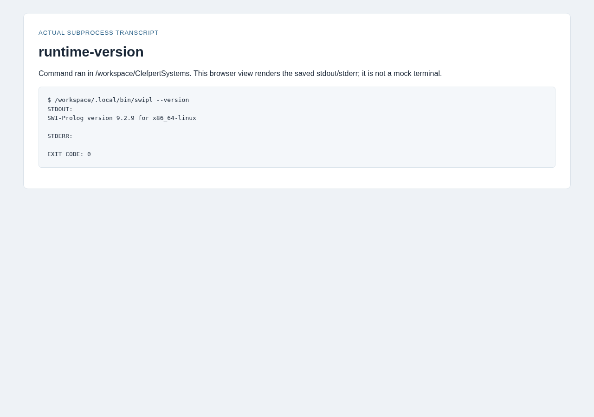

**Direct Prolog JSON bridge and unit conversion**

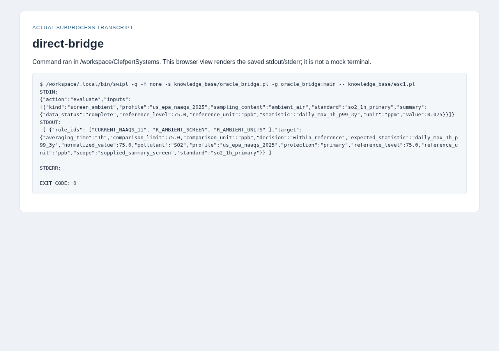

**All 55 consultation decisions and report checks**

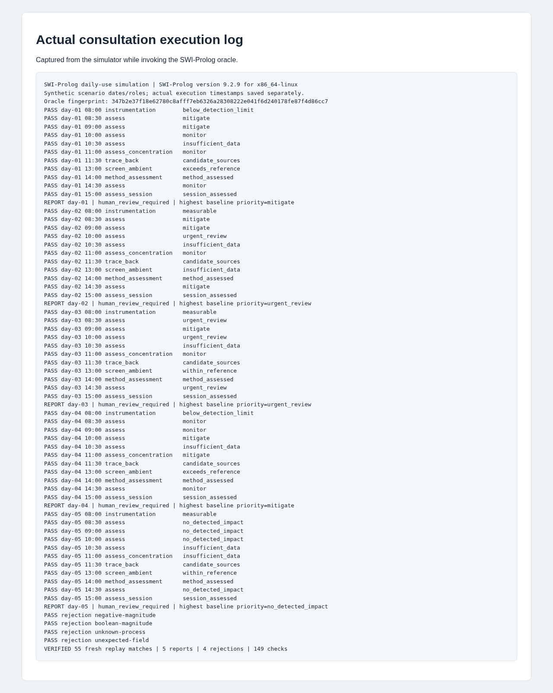

**Three Prolog tests**

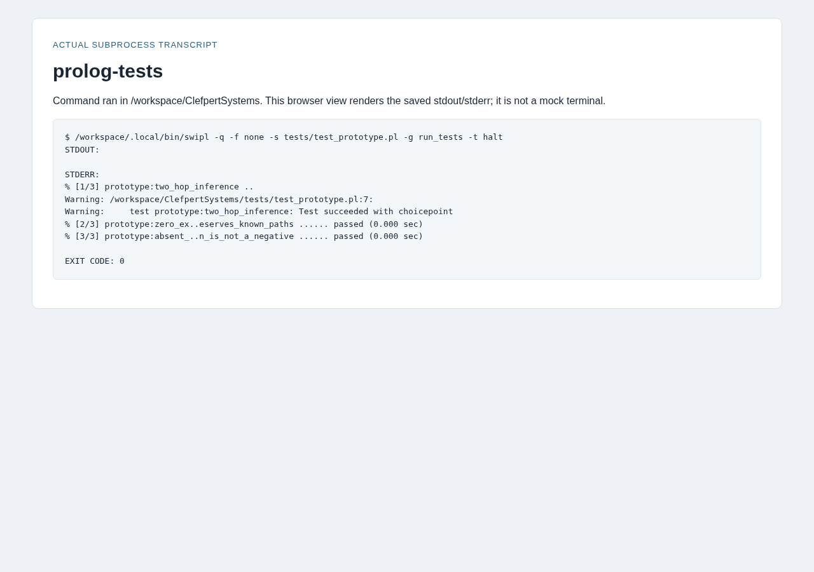

**32 Python regression tests**

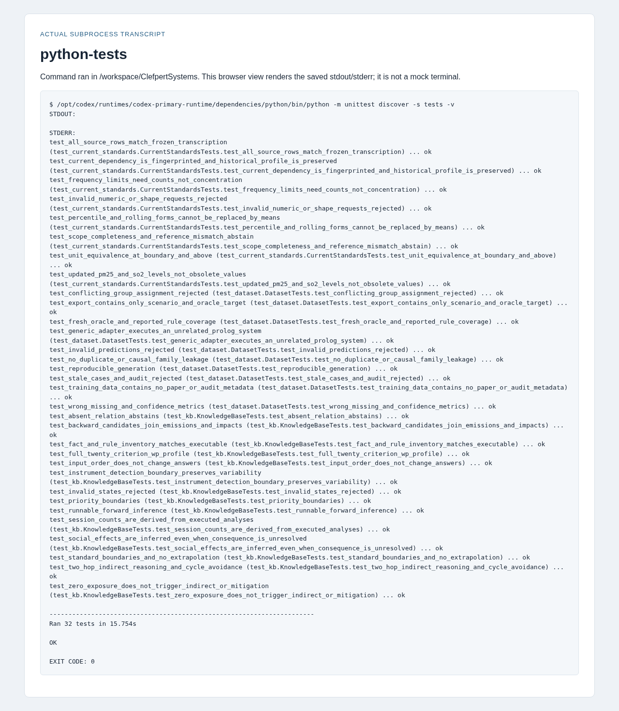

</details>

<details>
<summary>day-01 — Baseline desk review (report and all 11 consultations)</summary>

[Complete report JSON](docs/runs/daily-use/report-day-01.json) · [Report HTML](docs/runs/daily-use/report-day-01.html)

**Complete generated assessment-support report**

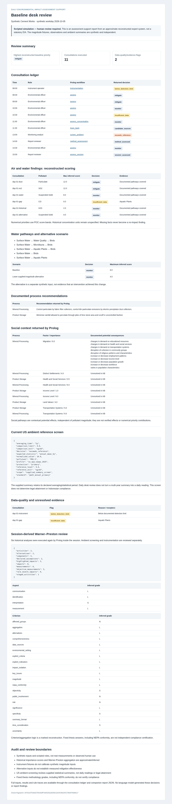

**08:00 · Instrument operator · `instrumentation`**

Review the synthetic observation against the documented instrument detection limit.


**08:30 · Environmental officer · `assess`**

Assess particulate pathways from processing and product storage.


**09:00 · Environmental officer · `assess`**

Assess documented SO2 effects on shrubs and birds.


**10:00 · Environmental officer · `assess`**

Trace direct surface-water and two-hop ecological pathways.


**10:30 · Environmental officer · `assess`**

Keep an unsupported CO-to-aquatic-plants relation unresolved.

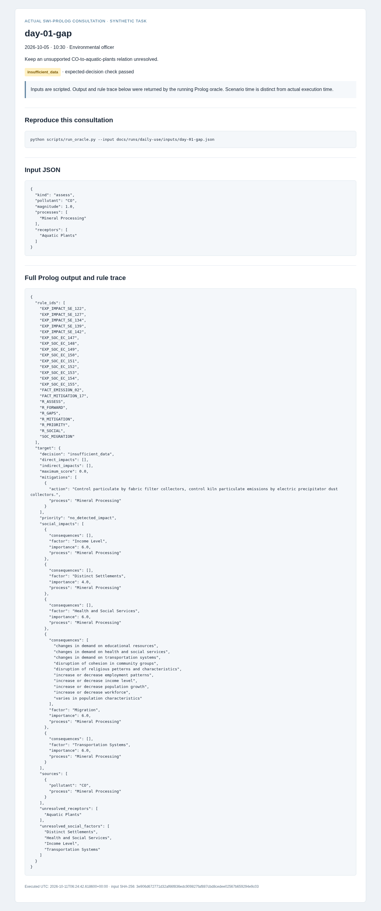

**11:00 · Environmental officer · `assess_concentration`**

Exercise the historical H2S source-scale bands without claiming physical units.

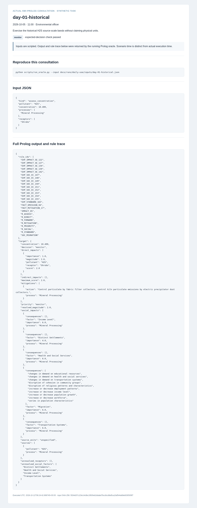

**11:30 · Environmental officer · `trace_back`**

Inspect candidate sources for birds; candidates do not prove causation.


**13:00 · Monitoring analyst · `screen_ambient`**

Review a synthetic stored statistical summary, not a new single daily measurement.

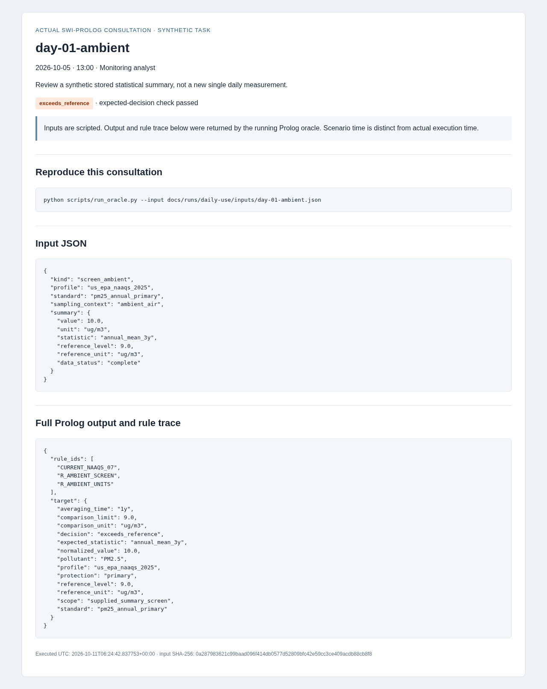

**14:00 · Report reviewer · `method_assessment`**

Review the inferred twenty-criterion methodology profile.

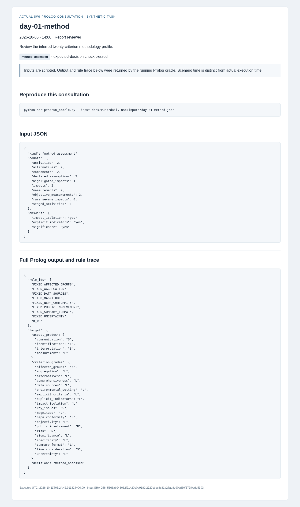

**14:30 · Environmental officer · `assess`**

Compare a lower supplied-magnitude alternative; no mitigation efficacy is claimed.


**15:00 · Report reviewer · `assess_session`**

Derive session counts from six executed historical analyses and prepare the daily report.


</details>

<details>
<summary>day-02 — Runoff concern and incomplete monitoring summary (report and all 11 consultations)</summary>

[Complete report JSON](docs/runs/daily-use/report-day-02.json) · [Report HTML](docs/runs/daily-use/report-day-02.html)

**Complete generated assessment-support report**

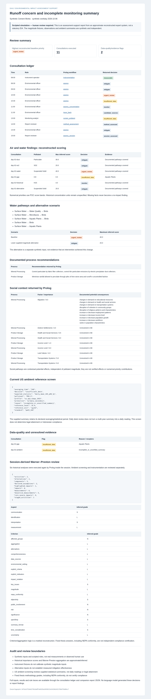

**08:00 · Instrument operator · `instrumentation`**

Review the synthetic observation against the documented instrument detection limit.


**08:30 · Environmental officer · `assess`**

Assess particulate pathways from processing and product storage.

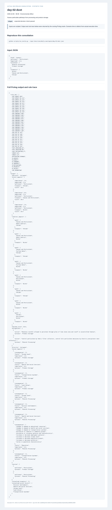

**09:00 · Environmental officer · `assess`**

Assess documented SO2 effects on shrubs and birds.


**10:00 · Environmental officer · `assess`**

Trace direct surface-water and two-hop ecological pathways.

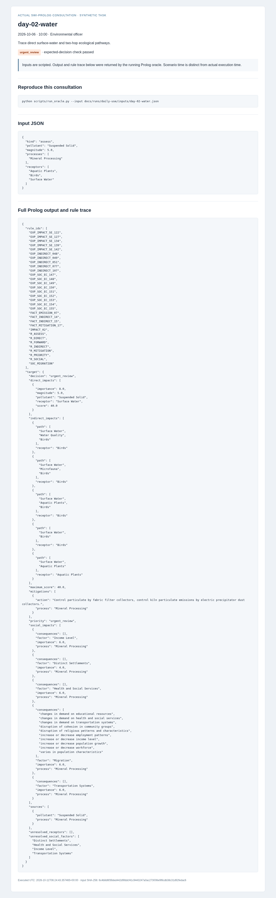

**10:30 · Environmental officer · `assess`**

Keep an unsupported CO-to-aquatic-plants relation unresolved.


**11:00 · Environmental officer · `assess_concentration`**

Exercise the historical H2S source-scale bands without claiming physical units.


**11:30 · Environmental officer · `trace_back`**

Inspect candidate sources for birds; candidates do not prove causation.


**13:00 · Monitoring analyst · `screen_ambient`**

Review a synthetic stored statistical summary, not a new single daily measurement.

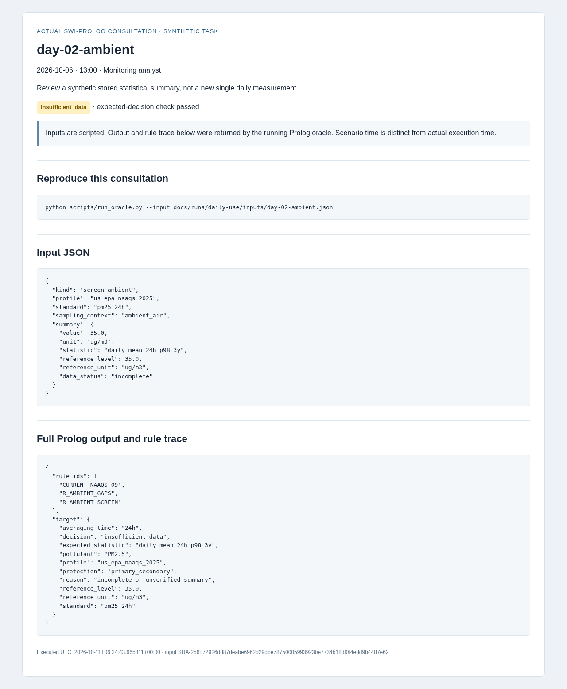

**14:00 · Report reviewer · `method_assessment`**

Review the inferred twenty-criterion methodology profile.


**14:30 · Environmental officer · `assess`**

Compare a lower supplied-magnitude alternative; no mitigation efficacy is claimed.

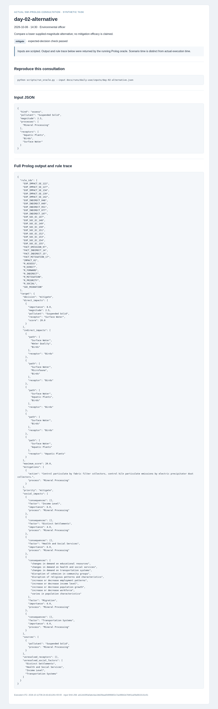

**15:00 · Report reviewer · `assess_session`**

Derive session counts from six executed historical analyses and prepare the daily report.


</details>

<details>
<summary>day-03 — Elevated simulated impacts and unit conversion (report and all 11 consultations)</summary>

[Complete report JSON](docs/runs/daily-use/report-day-03.json) · [Report HTML](docs/runs/daily-use/report-day-03.html)

**Complete generated assessment-support report**

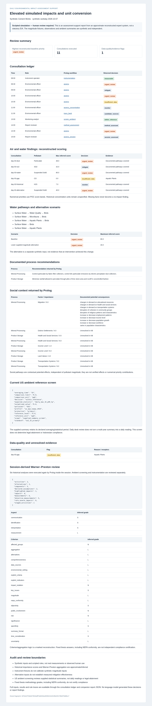

**08:00 · Instrument operator · `instrumentation`**

Review the synthetic observation against the documented instrument detection limit.

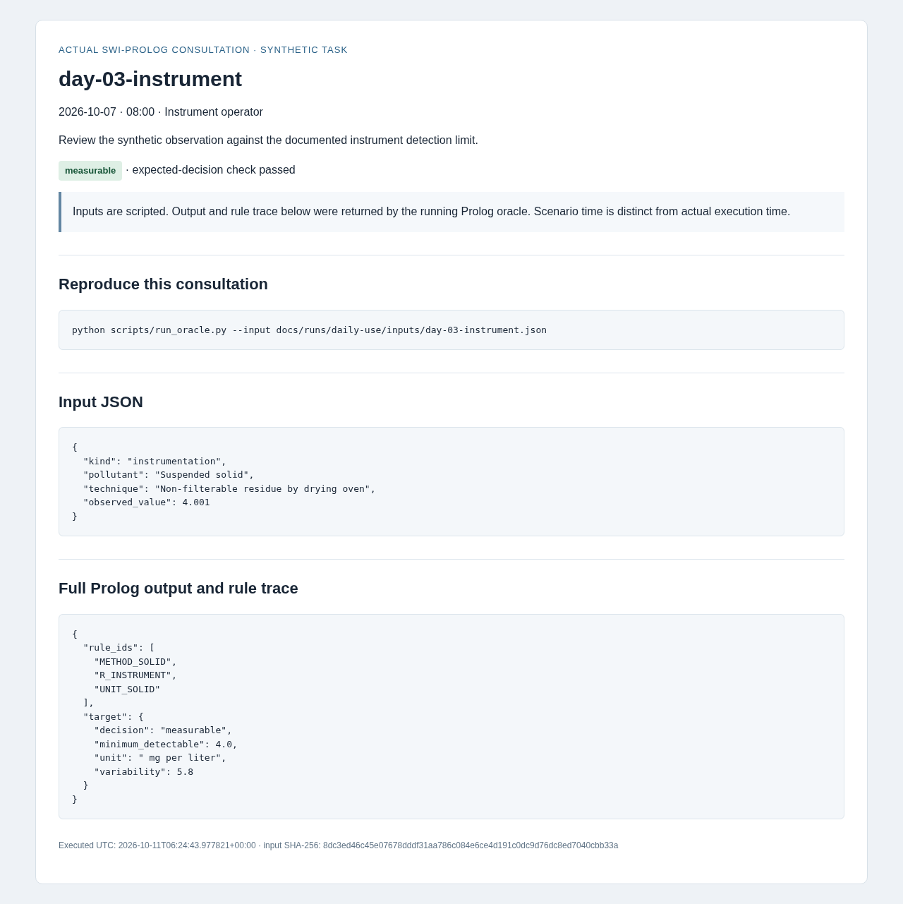

**08:30 · Environmental officer · `assess`**

Assess particulate pathways from processing and product storage.


**09:00 · Environmental officer · `assess`**

Assess documented SO2 effects on shrubs and birds.

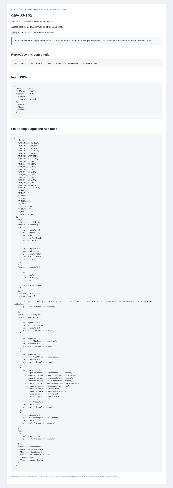

**10:00 · Environmental officer · `assess`**

Trace direct surface-water and two-hop ecological pathways.


**10:30 · Environmental officer · `assess`**

Keep an unsupported CO-to-aquatic-plants relation unresolved.


**11:00 · Environmental officer · `assess_concentration`**

Exercise the historical H2S source-scale bands without claiming physical units.

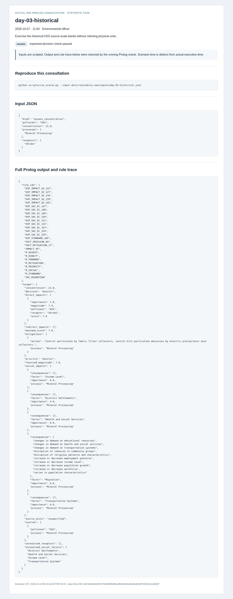

**11:30 · Environmental officer · `trace_back`**

Inspect candidate sources for birds; candidates do not prove causation.


**13:00 · Monitoring analyst · `screen_ambient`**

Review a synthetic stored statistical summary, not a new single daily measurement.

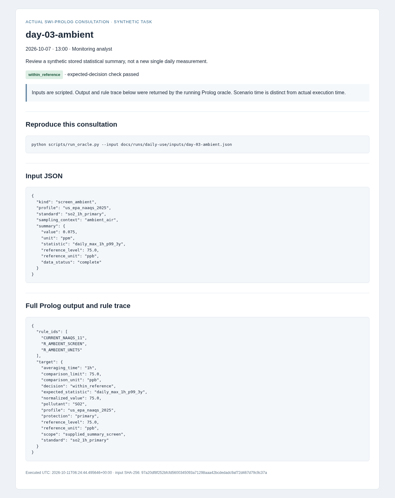

**14:00 · Report reviewer · `method_assessment`**

Review the inferred twenty-criterion methodology profile.

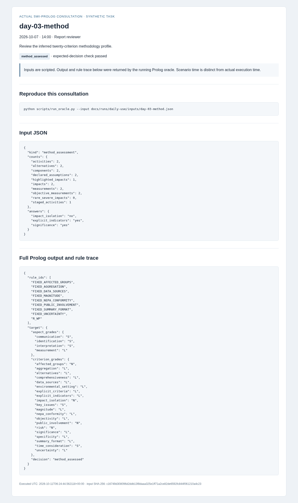

**14:30 · Environmental officer · `assess`**

Compare a lower supplied-magnitude alternative; no mitigation efficacy is claimed.


**15:00 · Report reviewer · `assess_session`**

Derive session counts from six executed historical analyses and prepare the daily report.


</details>

<details>
<summary>day-04 — Alternative scenario and CO frequency screen (report and all 11 consultations)</summary>

[Complete report JSON](docs/runs/daily-use/report-day-04.json) · [Report HTML](docs/runs/daily-use/report-day-04.html)

**Complete generated assessment-support report**

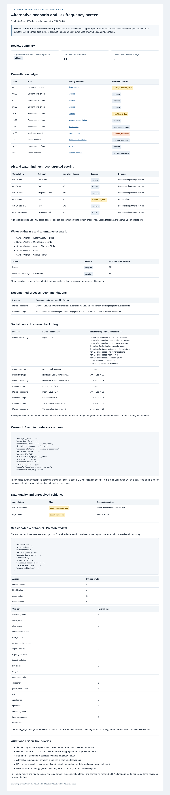

**08:00 · Instrument operator · `instrumentation`**

Review the synthetic observation against the documented instrument detection limit.

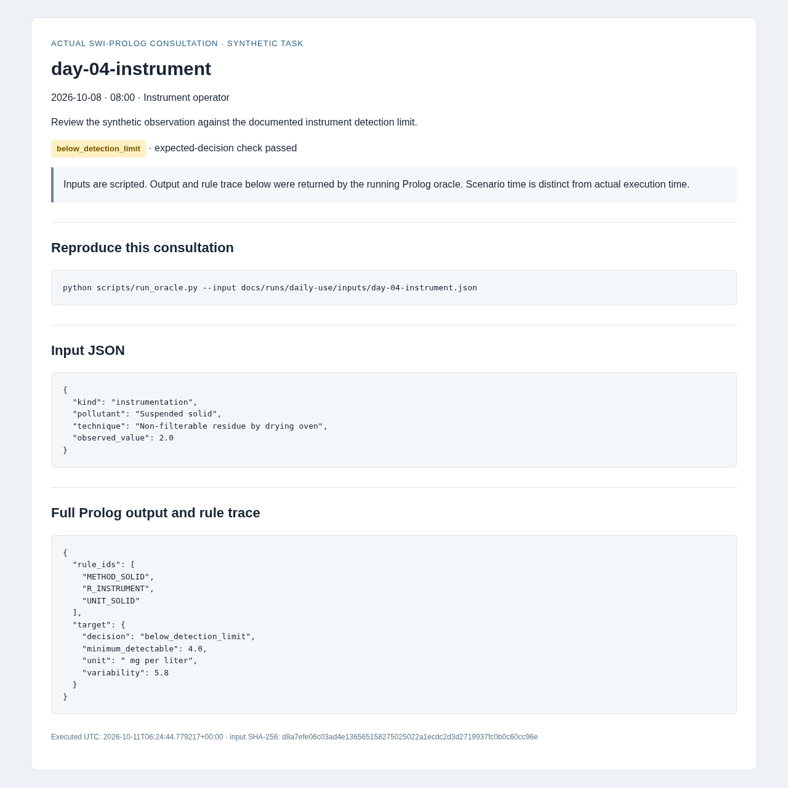

**08:30 · Environmental officer · `assess`**

Assess particulate pathways from processing and product storage.


**09:00 · Environmental officer · `assess`**

Assess documented SO2 effects on shrubs and birds.


**10:00 · Environmental officer · `assess`**

Trace direct surface-water and two-hop ecological pathways.


**10:30 · Environmental officer · `assess`**

Keep an unsupported CO-to-aquatic-plants relation unresolved.


**11:00 · Environmental officer · `assess_concentration`**

Exercise the historical H2S source-scale bands without claiming physical units.


**11:30 · Environmental officer · `trace_back`**

Inspect candidate sources for birds; candidates do not prove causation.


**13:00 · Monitoring analyst · `screen_ambient`**

Review a synthetic stored statistical summary, not a new single daily measurement.

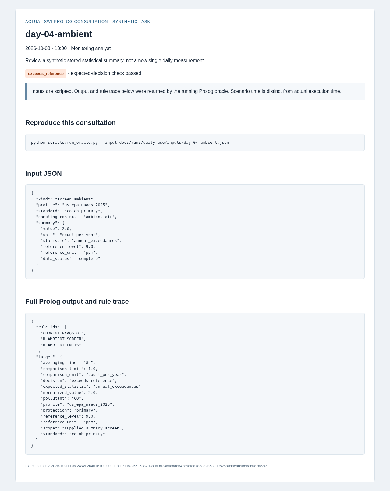

**14:00 · Report reviewer · `method_assessment`**

Review the inferred twenty-criterion methodology profile.


**14:30 · Environmental officer · `assess`**

Compare a lower supplied-magnitude alternative; no mitigation efficacy is claimed.


**15:00 · Report reviewer · `assess_session`**

Derive session counts from six executed historical analyses and prepare the daily report.


</details>

<details>
<summary>day-05 — Zero-exposure scenario and unresolved historical range (report and all 11 consultations)</summary>

[Complete report JSON](docs/runs/daily-use/report-day-05.json) · [Report HTML](docs/runs/daily-use/report-day-05.html)

**Complete generated assessment-support report**

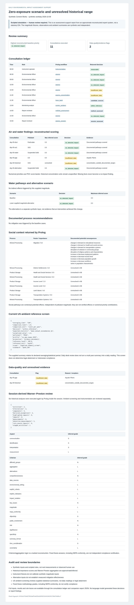

**08:00 · Instrument operator · `instrumentation`**

Review the synthetic observation against the documented instrument detection limit.

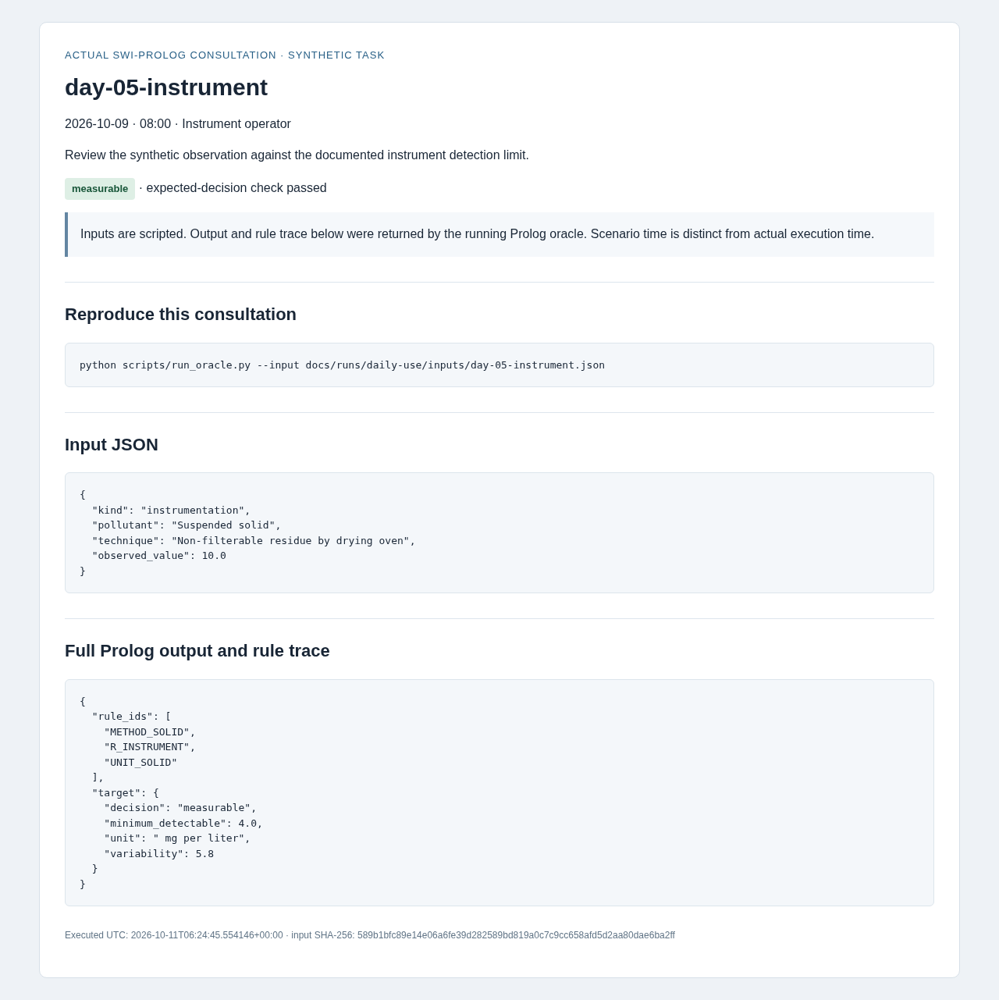

**08:30 · Environmental officer · `assess`**

Assess particulate pathways from processing and product storage.

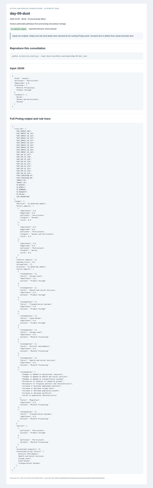

**09:00 · Environmental officer · `assess`**

Assess documented SO2 effects on shrubs and birds.

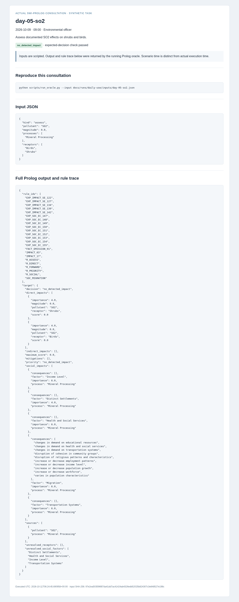

**10:00 · Environmental officer · `assess`**

Trace direct surface-water and two-hop ecological pathways.

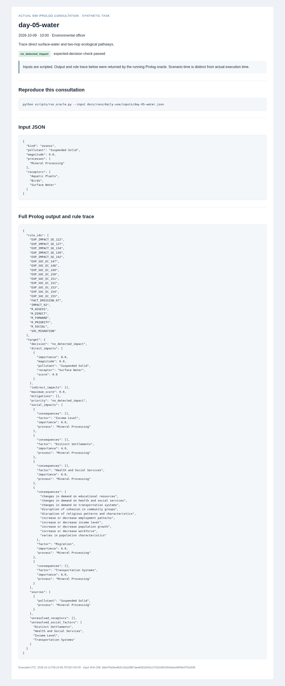

**10:30 · Environmental officer · `assess`**

Keep an unsupported CO-to-aquatic-plants relation unresolved.

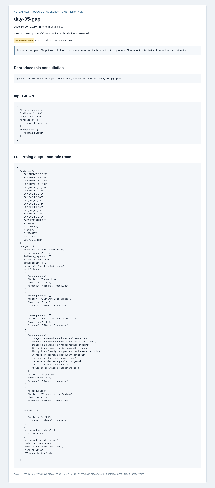

**11:00 · Environmental officer · `assess_concentration`**

Exercise the historical H2S source-scale bands without claiming physical units.

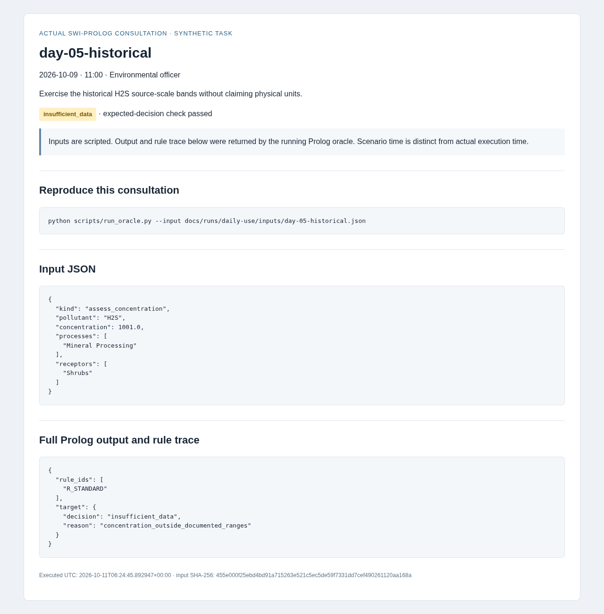

**11:30 · Environmental officer · `trace_back`**

Inspect candidate sources for birds; candidates do not prove causation.


**13:00 · Monitoring analyst · `screen_ambient`**

Review a synthetic stored statistical summary, not a new single daily measurement.


**14:00 · Report reviewer · `method_assessment`**

Review the inferred twenty-criterion methodology profile.


**14:30 · Environmental officer · `assess`**

Compare a lower supplied-magnitude alternative; no mitigation efficacy is claimed.

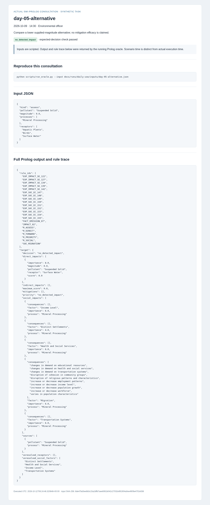

**15:00 · Report reviewer · `assess_session`**

Derive session counts from six executed historical analyses and prepare the daily report.


</details>

<details>
<summary>All four malformed-input rejections</summary>

**negative-magnitude**

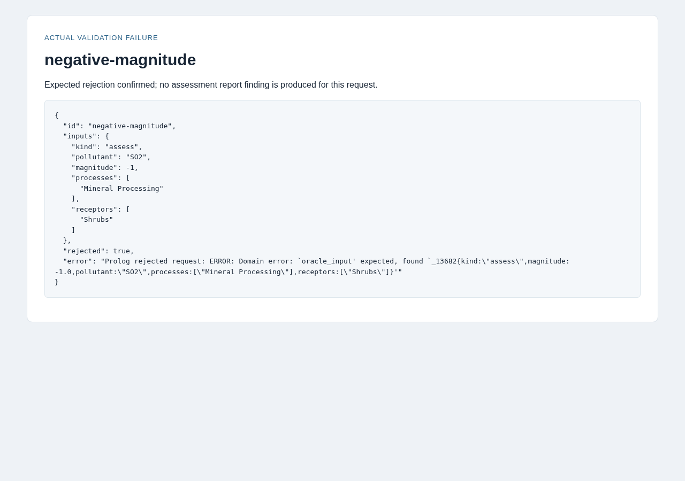

**boolean-magnitude**

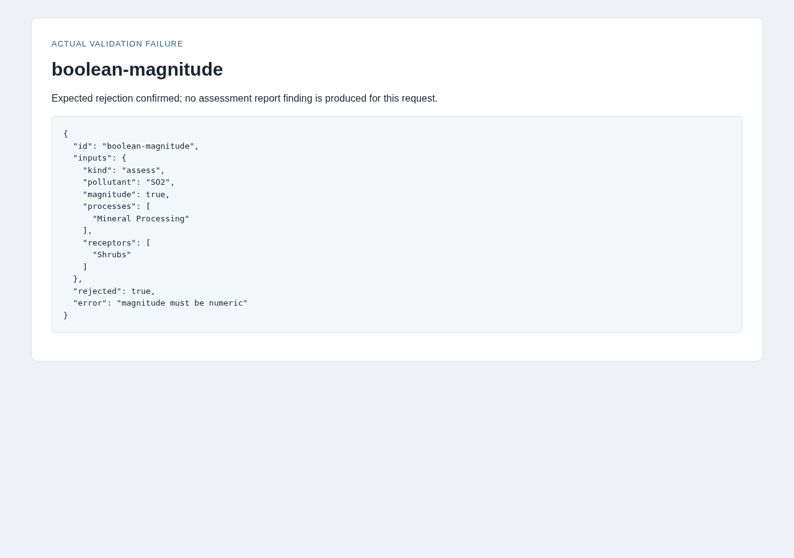

**unknown-process**

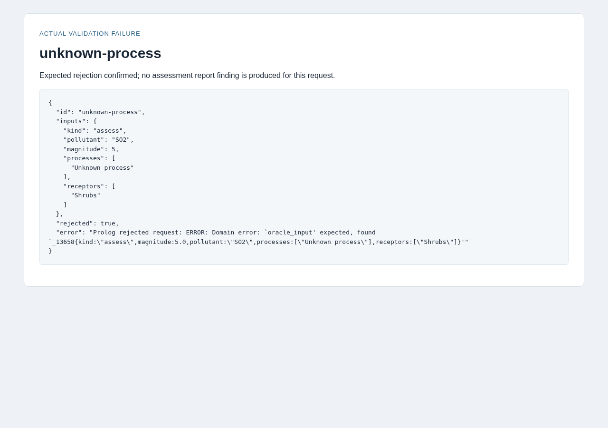

**unexpected-field**

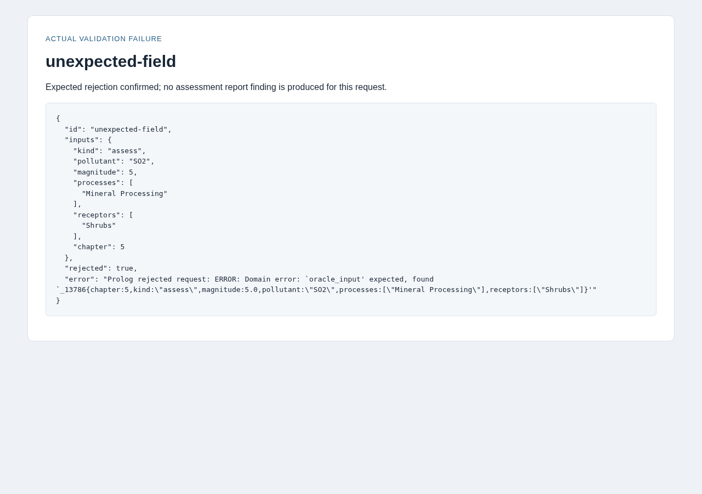

</details>

To rerun in this environment (core execution requires Python and SWI-Prolog; screenshots additionally require Playwright/Chromium):

```sh
export SWIPL=/workspace/.local/bin/swipl
python scripts/simulate_daily_use.py
python scripts/verify_daily_use.py
python scripts/capture_daily_use.py --browser-executable /usr/bin/chromium
```

On another machine, use `swipl` on PATH or set `SWIPL` to its installed executable. See the [testing plan](docs/daily-use-testing.md) for dependency installation and static-report browsing. Report artifacts stay in `docs/runs/`, outside model-training records.

<!-- END DAILY USE RUN -->

## Data boundaries

`dataset/generated/train.jsonl`, `validation.jsonl` and `test.jsonl` contain case inputs and Prolog-produced decisions, plus IDs/split bookkeeping. Model exports contain only prompt/target pairs. Chapter numbers, prose summaries, source citations, assumptions and rule traces live in `docs/evidence/`, `knowledge_base/provenance.yaml` and the separate `dataset/generated/audit.jsonl`; they are not model inputs or targets.

`train.prompt_completion.jsonl` is a ready-to-inspect generic pair export. `messages` is also supported. For `--format clef`, supply the actual versioned Clef pair-format contract with `--contract`; no undocumented Clef schema is guessed. No fine-tuning is performed here. `examples/test_predictions.jsonl` copies oracle outputs purely to check evaluation wiring and is not model performance evidence.

## Translate another system

```sh
python scripts/translate_prolog.py --kb examples/tiny_kb.pl --states examples/tiny_states.jsonl --output /tmp/tiny-dataset --format prompt_completion
```

This unrelated thermostat example demonstrates the general adapter. Future Datalog and other symbolic backends can implement the same executable oracle protocol.

The reconstructed priority cutoffs, score arithmetic, interval boundaries and Warner–Preston aggregation are POC assumptions, not the original historical algorithms. Uncovered relationships remain unresolved. Agreements measure the **versioned reconstructed program**, not historical equivalence or regulatory validity.
